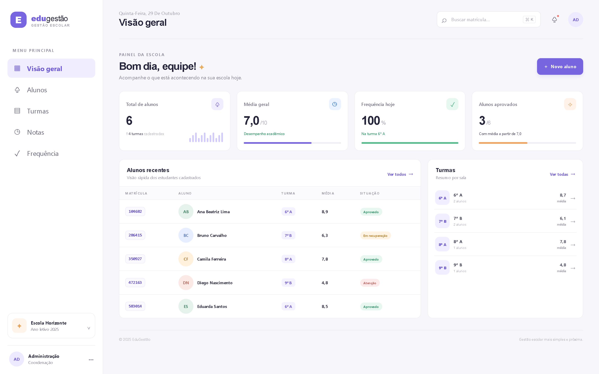
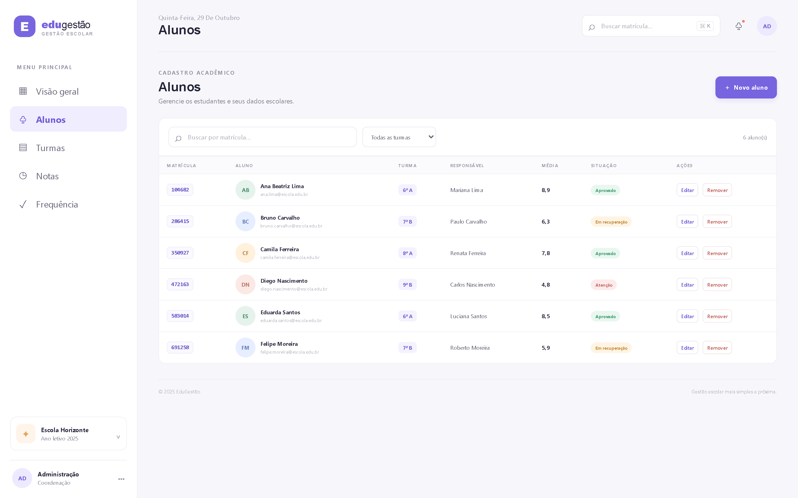
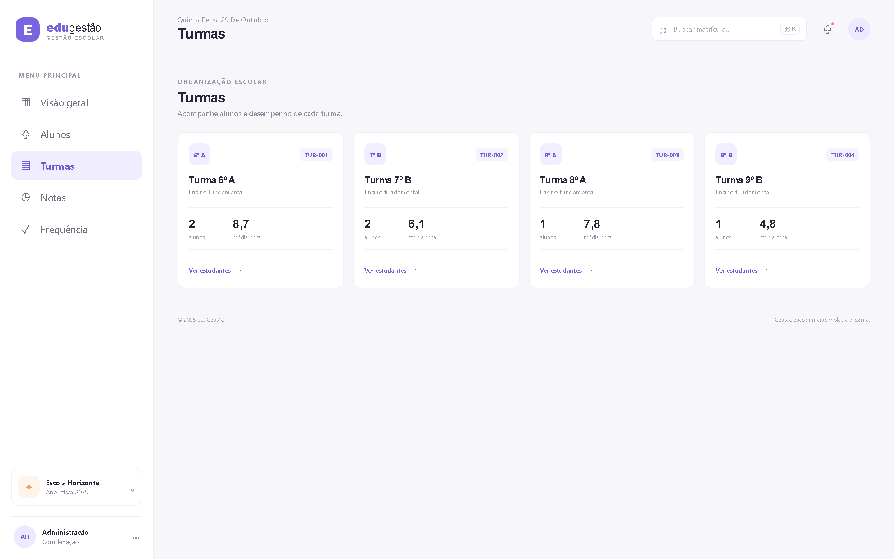
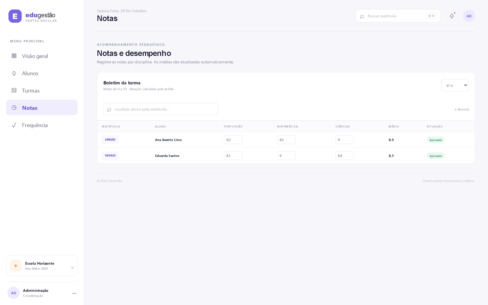
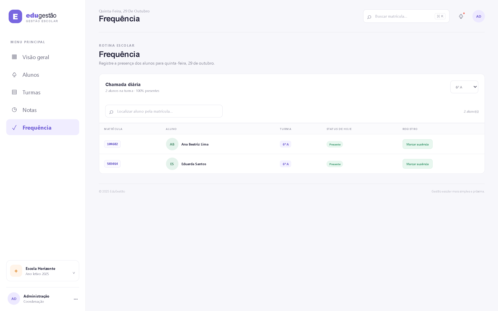

# 🎓 EduGestão

Painel responsivo de gestão acadêmica escolar para professores e coordenação, construído com **Vue 3** e **Vite**. Permite cadastrar alunos, lançar notas, registrar frequência e acompanhar indicadores por turma.


---

## 🖼️ Telas

**Visão geral** — indicadores de matrículas, média escolar, aprovações e frequência do dia.



| Alunos | Turmas |
| :---: | :---: |
|  |  |

| Notas | Frequência |
| :---: | :---: |
|  |  |

---

## 📌 Sobre o projeto

Sistema criado a partir de uma necessidade real de sala de aula: professores e coordenadores precisam consultar e editar notas e informações dos alunos de forma simples. O EduGestão reúne essas tarefas em um painel único, com navegação por telas e indicadores calculados automaticamente.

É um **protótipo de interface**: funciona 100% no navegador, sem servidor e sem banco de dados.

---

## ✨ Funcionalidades

**Visão geral**
- Painel com indicadores de matrículas, média escolar, aprovações e frequência.

**Alunos**
- Cadastro, edição e remoção de alunos.
- Busca por matrícula e filtro por turma.
- Matrícula numérica única de seis dígitos, gerada automaticamente.
- A matrícula **não** é derivada de CPF, CEP ou data de nascimento.

**Turmas**
- Consulta do número de estudantes e da média de cada turma.

**Notas**
- Lançamento de notas de Português, Matemática e Ciências.
- Cálculo automático da média e da situação do aluno (aprovado, recuperação ou reprovado).

**Frequência**
- Chamada diária com registro de presença ou ausência por aluno.

**Geral**
- Persistência local dos cadastros, notas e registros de frequência no navegador.
- Layout responsivo (desktop, tablet e celular).

---

## 🚀 Como executar

### Pré-requisitos

- **Node.js 18+** instalado

### Passo a passo

```bash
# 1. Clone o repositório
git clone https://github.com/Rocksd2/EduGest-o.git

# 2. Entre na pasta
cd EduGest-o

# 3. Instale as dependências
npm install

# 4. Rode em modo de desenvolvimento
npm run dev
```

O Vite abre o projeto em `http://localhost:5173`.

Para gerar a versão de produção:

```bash
npm run build     # gera a pasta dist/
npm run preview   # serve a build localmente
```

---

## 🗂️ Estrutura do projeto

```
EduGest-o/
├── docs/                  # capturas de tela usadas no README
│   ├── preview.png        # visão geral
│   ├── alunos.png
│   ├── turmas.png
│   ├── notas.png
│   └── frequencia.png
├── index.html             # ponto de entrada HTML
├── vite.config.js
├── package.json
└── src/
    ├── App.vue            # navegação, estado, regras de negócio e telas
    ├── main.js            # inicialização da aplicação Vue
    ├── assets/
    │   └── main.css       # estilos responsivos e variáveis visuais
    └── components/        # componentes extraídos (ver nota abaixo)
```

> ⚠️ **Nota técnica:** os componentes em `src/components/` (`AppHeader`, `AppFooter`, `FormAluno`, `ListaAlunos`, `MembroEquipe`, `ResumoCard`) foram criados, mas **ainda não estão sendo importados** — hoje toda a interface vive em `App.vue`. A refatoração para usá-los está no roadmap.

---

## 🧠 O que foi praticado

- **Vue 3 com Composition API**: `ref`, `computed` e `watch` para controlar estado e reatividade
- **Estado derivado**: indicadores, médias e situações são calculados por `computed`, nunca armazenados duplicados
- **Persistência no cliente**: serialização em JSON no `localStorage`, com `watch` de profundidade (`deep: true`) para salvar automaticamente
- **Migração de dados**: rotina que gera matrícula para registros antigos que ainda não tinham o campo
- **Manipulação de listas**: busca por matrícula, filtro por turma e atualização imutável de registros
- **UX de formulário**: modal de cadastro/edição com validação e mensagens de erro
- **CSS responsivo**: variáveis de tema, grid e breakpoints sem framework de UI

---

## ⚠️ Limitações conhecidas

- **Sem back-end**: não há API, autenticação ou banco de dados. Os dados ficam no `localStorage` do navegador e **não são compartilhados** entre dispositivos ou usuários.
- **Dados de demonstração**: a lista inicial é composta por alunos fictícios.
- **Sem controle de acesso**: qualquer pessoa com acesso ao navegador vê e edita tudo.
- **Sem histórico**: a chamada é registrada por dia, mas não há relatório consolidado de faltas por período.

Para uso real por uma escola, seria necessário integrar autenticação, servidor e armazenamento persistente.

---

## 🛣️ Próximos passos

- [ ] Refatorar `App.vue` em componentes reutilizáveis (usar os de `src/components/`)
- [ ] Criar API com autenticação de professor e coordenação
- [ ] Migrar os dados do `localStorage` para banco de dados
- [ ] Adicionar relatório de faltas e boletim por bimestre
- [ ] Exportar boletim em PDF
- [ ] Escrever testes unitários dos cálculos de média e situação

---

## 👤 Autor

**Alexander Protasio**

[](https://www.linkedin.com/in/alexander-protasio-26a84222a/)
[](https://github.com/Rocksd2)
[](mailto:alexanderprotasio@gmail.com)
