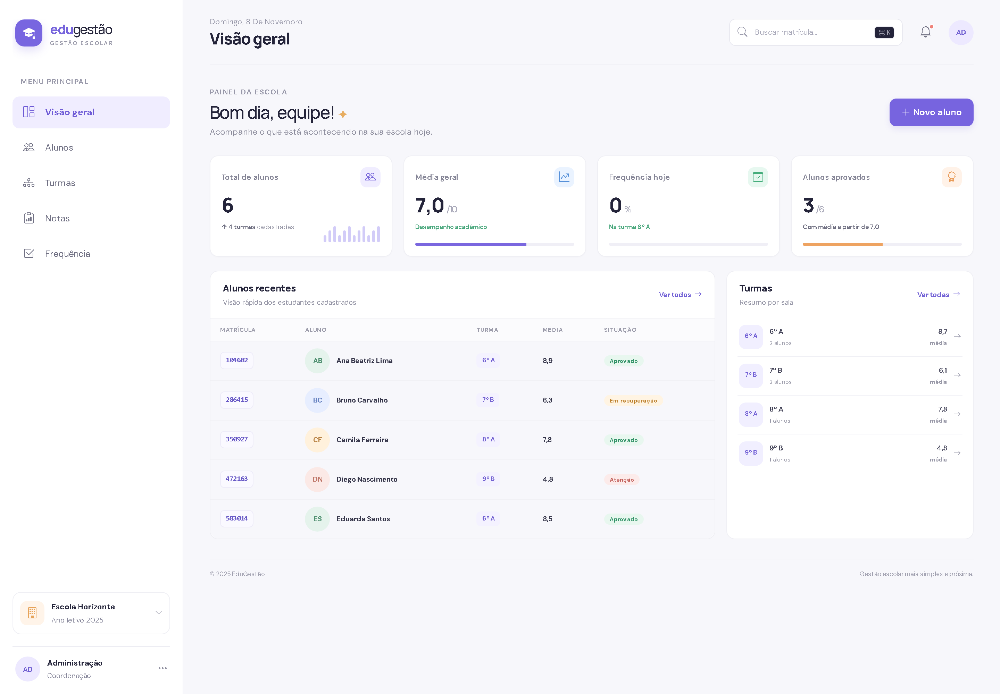
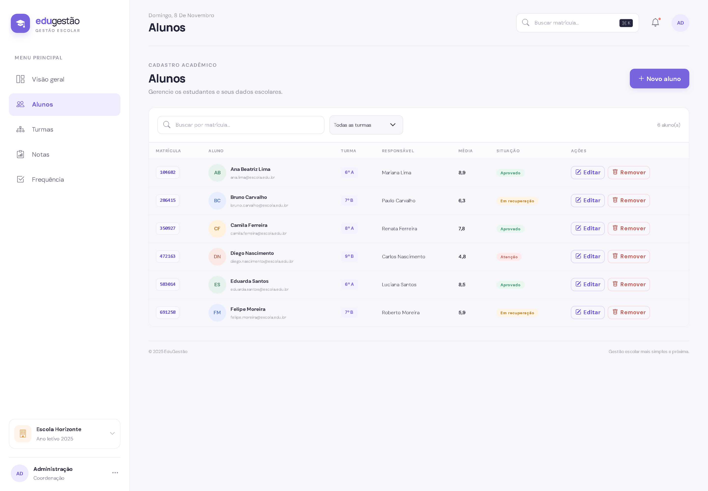
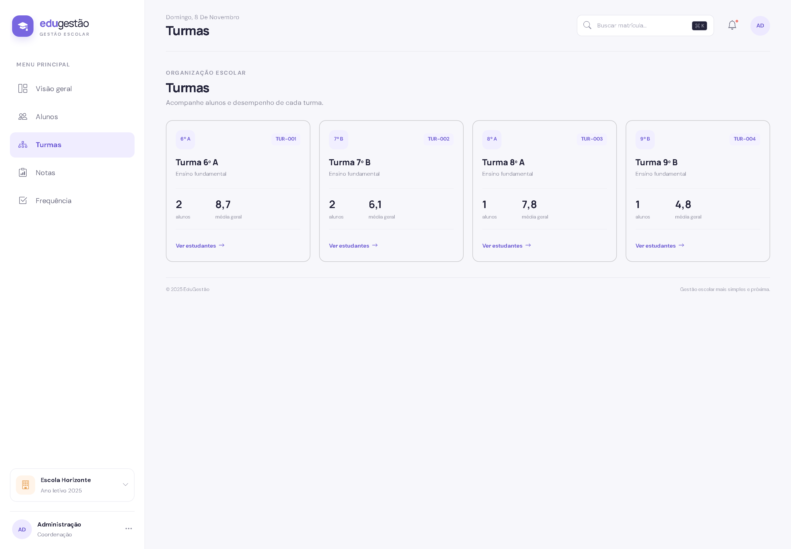
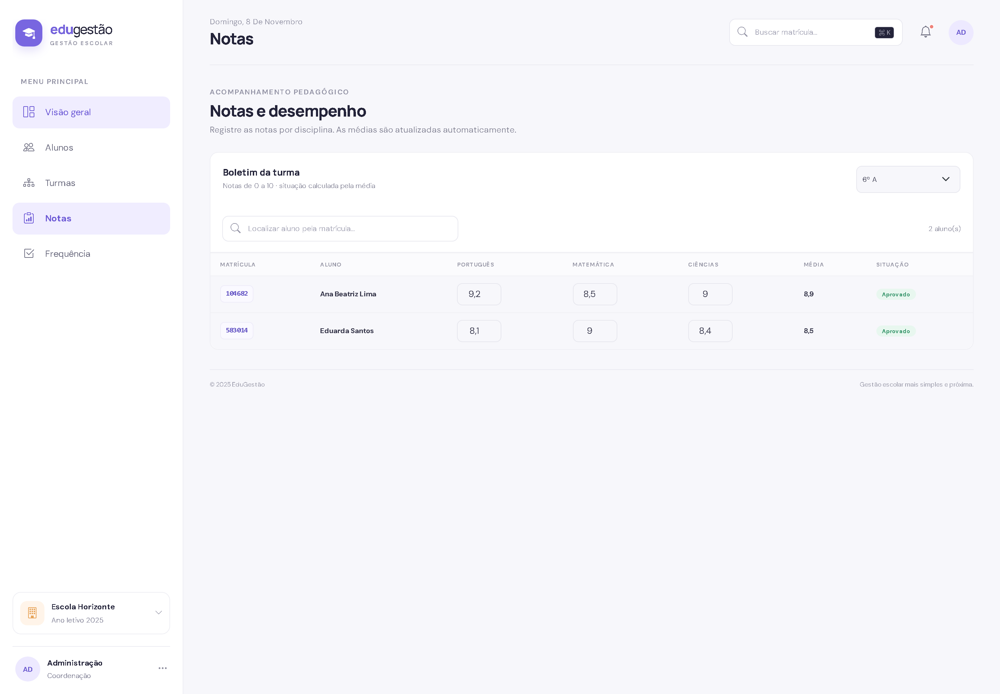
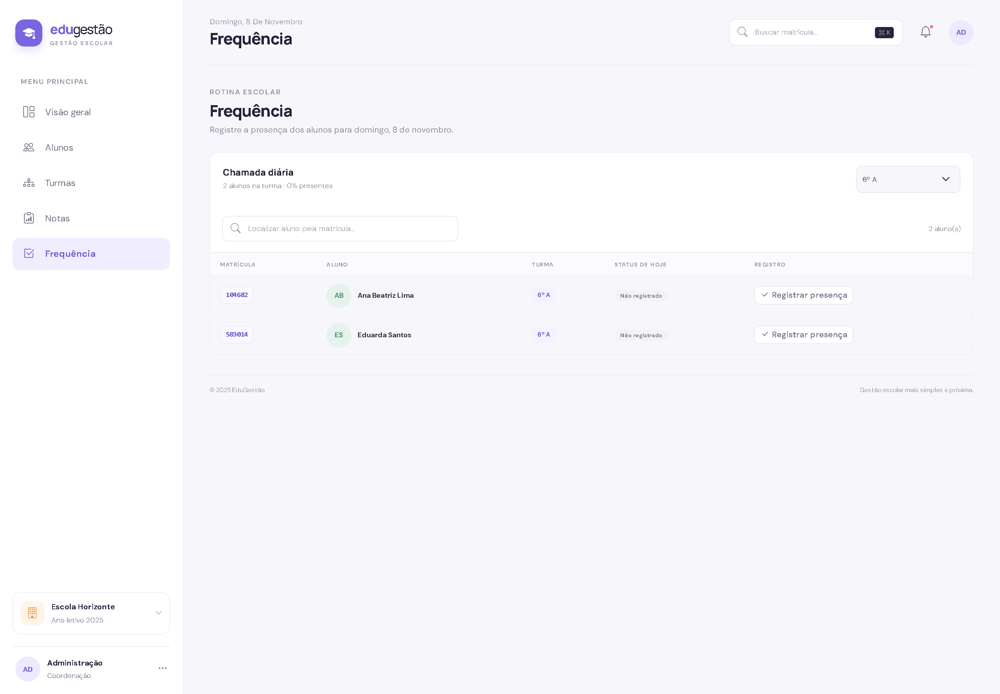
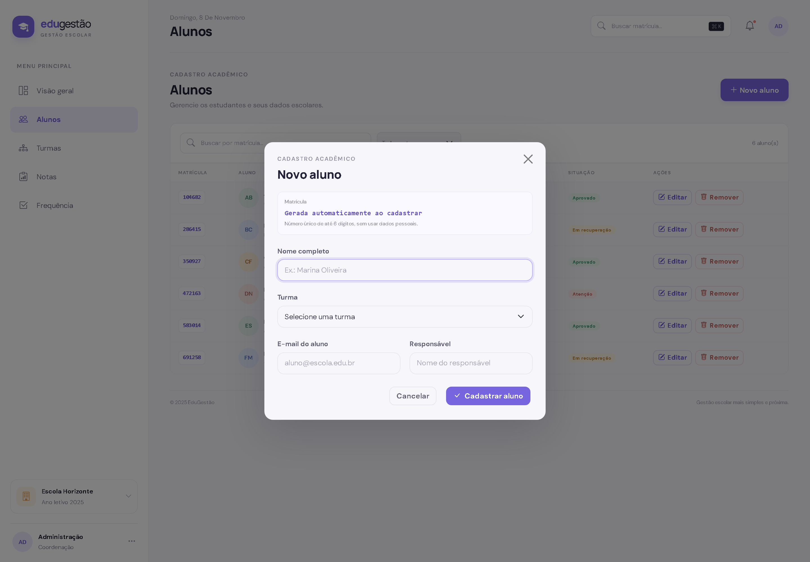
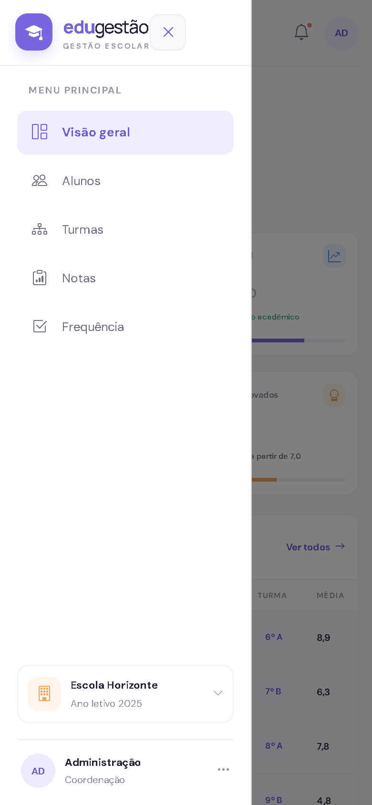
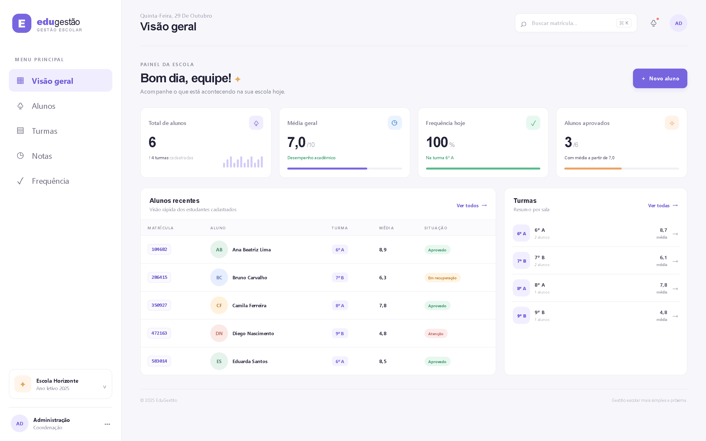
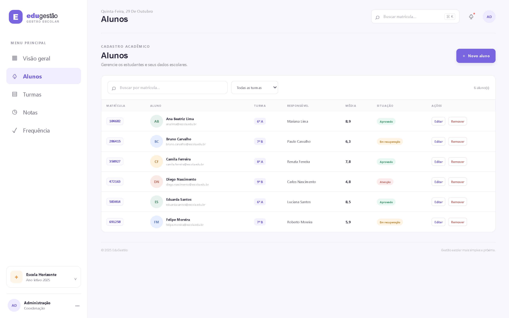
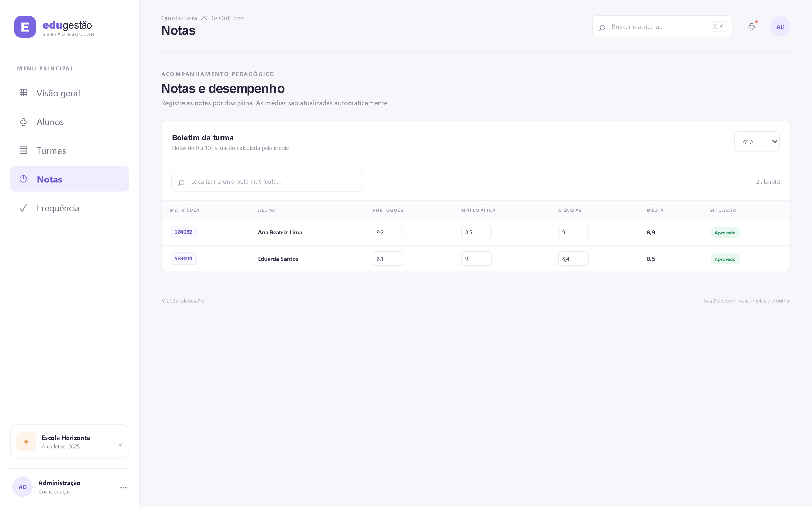

# 🎓 EduGestão

Painel responsivo de gestão acadêmica escolar para professores e coordenação, construído com **Vue 3**, **Vite** e **Bootstrap 5**. Permite cadastrar alunos, lançar notas, registrar frequência e acompanhar indicadores por turma.

[](https://vuejs.org/)
[](https://vite.dev/)
[](https://getbootstrap.com/)
[](#-limitações-conhecidas)
[](#-limitações-conhecidas)

---

## 📊 Apresentação

- **[Deck navegável](apresentacao/index.html)** — 6 telas no tema do app. Use `↑`/`↓` para navegar e `F` para tela cheia.
- **[PDF da apresentação](apresentacao/EduGestao-Bootstrap5.pdf)** — versão para entrega (6 páginas, 16:9).
- **[Roteiro de 5 minutos](apresentacao/roteiro.md)** — fala por slide, checklist da demo e respostas para as perguntas prováveis.

[](apresentacao/index.html)

---

## 🖼️ Telas

**Visão geral** — indicadores de matrículas, média escolar, aprovações e frequência do dia.

[](docs/preview.png)

| Alunos | Turmas |
| --- | --- |
| [](docs/alunos.png) | [](docs/turmas.png) |

| Notas | Frequência |
| --- | --- |
| [](docs/notas.png) | [](docs/frequencia.png) |

| Modal de cadastro | Mobile |
| --- | --- |
| [](docs/modal.png) | [](docs/mobile-menu.png) |

### Antes e depois

As capturas da primeira versão foram preservadas para comparação:

| Antes (1ª avaliação) | Depois (Bootstrap 5) |
| --- | --- |
| [](docs/antes-visao-geral.png) | [](docs/preview.png) |
| [](docs/antes-alunos.png) | [](docs/alunos.png) |
| [](docs/antes-notas.png) | [](docs/notas.png) |

---

## 📌 Sobre o projeto

Sistema criado a partir de uma necessidade real de sala de aula: professores e coordenadores precisam consultar e editar notas e informações dos alunos de forma simples. O EduGestão reúne essas tarefas em um painel único, com navegação por telas e indicadores calculados automaticamente.

É um **protótipo de interface**: funciona 100% no navegador, sem servidor e sem banco de dados. Nesta versão, o projeto recebeu o **Bootstrap 5** como framework CSS, mantendo as funcionalidades e a reatividade em Vue.js.

---

## ✨ Funcionalidades

**Visão geral**

- Painel com indicadores de matrículas, média escolar, aprovações e frequência.
- Cards responsivos com barras de progresso do Bootstrap.

**Alunos**

- Cadastro, edição e remoção de alunos.
- Busca por matrícula e filtro por turma.
- Matrícula numérica única de seis dígitos, gerada automaticamente.
- A matrícula **não** é derivada de CPF, CEP ou data de nascimento.

**Turmas**

- Consulta do número de estudantes e da média de cada turma.

**Notas**

- Lançamento de notas de Português, Matemática e Ciências.
- Cálculo automático da média e da situação do aluno (aprovado, recuperação ou atenção).
- Filtro por turma independente do filtro da tela de alunos.

**Frequência**

- Chamada diária com registro de presença ou ausência por aluno.
- Selos de status (`badge`) do Bootstrap.

**Geral**

- Persistência local dos cadastros, notas e registros de frequência no navegador.
- Layout responsivo (desktop, tablet e celular), com menu lateral em `offcanvas` no mobile.

---

## 🎨 Framework CSS: Bootstrap 5

### Por que Bootstrap?

- Já oferece **componentes prontos** (cards, tabelas, modais, botões, formulários, badges) que cobrem exatamente os elementos da aplicação.
- O **grid responsivo** (`row`, `col-*`, `row-cols-*`) resolve a adaptação para tablet e celular sem reescrever a estilização.
- As **classes utilitárias** (`d-none`, `d-md-flex`, `gap-*`, `h-100`, `align-middle`) tornam a responsividade explícita no template.
- É fácil de explicar e defender na apresentação, pois os nomes das classes descrevem o que fazem.

### Como foi integrado

Instalação via npm (recomendado em projetos Vite):

```bash
npm install bootstrap bootstrap-icons
```

Importação em `src/main.js`, **antes** do CSS do projeto:

```js
import 'bootstrap/dist/css/bootstrap.min.css'
import 'bootstrap-icons/font/bootstrap-icons.css'
import './assets/main.css'
```

O `main.css` é carregado por último para que o tema do EduGestão sobrescreva cores, fontes e espaçamentos do Bootstrap quando necessário. A customização usa as **variáveis CSS do próprio Bootstrap** (`--bs-primary`, `--bs-body-font-family`, `--bs-border-radius` etc.) e as variáveis internas dos componentes (`--bs-btn-bg`, `--bs-progress-bar-bg`).

### Classes e recursos utilizados

| Classe / recurso | Onde foi usada | O que faz |
| --- | --- | --- |
| `offcanvas-lg` + `offcanvas-start` + `show` | Menu lateral | No desktop vira menu fixo; abaixo de 992px vira gaveta lateral controlada pelo estado `menuAberto` do Vue. |
| `row`, `col-*`, `row-cols-*`, `g-3` | Cards, turmas e grade do painel | Grid responsivo: 2 cards por linha no celular e 4 no desktop, com espaçamento consistente. |
| `card`, `card-body`, `h-100` | Cards de indicadores e turmas | Estrutura pronta de card, com altura igual entre os itens da mesma linha. |
| `table`, `table-hover`, `table-responsive`, `align-middle` | Todas as tabelas | Padrão visual de tabela, destaque no hover, rolagem horizontal no celular e alinhamento vertical. |
| `modal`, `modal-dialog`, `modal-content`, `modal-header/body/footer` | Cadastro/edição de aluno | Estrutura completa do modal, com cabeçalho, corpo e rodapé de ações. |
| `btn`, `btn-primary`, `btn-outline-primary`, `btn-outline-danger`, `btn-sm` | Botões da aplicação | Botões com estados de hover/focus e variações de cor e tamanho. |
| `form-control`, `form-select`, `form-label`, `is-invalid` | Formulário do modal | Campos padronizados, foco acessível e indicação visual de erro. |
| `progress`, `progress-bar` | Cards de média, frequência e aprovação | Barras de progresso com `role="progressbar"` e largura calculada por `computed`. |
| `badge`, `rounded-pill` | Situação do aluno e frequência | Selos arredondados para aprovado, recuperação, atenção e pendente. |
| `d-none`, `d-md-flex`, `d-lg-none`, `d-xl-inline` | Cabeçalho, menu e ações | Utilitários de exibição por breakpoint (esconder busca no celular, mostrar hambúrguer etc.). |
| `alert`, `alert-danger` | Erro do formulário | Mensagem de validação com o padrão visual do Bootstrap. |
| `d-flex`, `flex-column`, `flex-sm-row`, `justify-content-between`, `gap-*` | Cabeçalhos das páginas e rodapé | Utilitários de layout flexbox para empilhar no celular e alinhar no desktop. |

> **Observação:** o Bootstrap foi usado como base de componentes e responsividade, mas o projeto mantém sua identidade visual (paleta lilás, tipografia Manrope/DM Sans e cartões com detalhes próprios) por meio de CSS customizado.

---

## 🧩 Componentização Vue

O estado e as regras de negócio continuam centralizados em `src/App.vue`, que agora orquestra componentes menores:

| Componente | Responsabilidade | Recursos Vue |
| --- | --- | --- |
| `AppSidebar.vue` | Marca, menu de navegação, escola e perfil | `props`, `emits` |
| `AppHeader.vue` | Título, data, busca, notificações e avatar | `defineModel`, `props`, `emits` |
| `ResumoCard.vue` | Card de indicador com ícone, valor e progresso | `props`, `slot` nomeado |
| `StatusBadge.vue` | Selo de situação | `props` |
| `FormAluno.vue` | Modal de cadastro/edição e validação | `props`, `emits`, `watch`, `nextTick`, `v-model` |
| `AppFooter.vue` | Rodapé | `props` |

Os componentes `ListaAlunos.vue` e `MembroEquipe.vue` são legados da primeira versão e não são usados pela interface atual.

---

## 📱 Responsividade

- **Desktop (≥ 1200px):** menu fixo de 264px, 4 cards por linha e painel em duas colunas.
- **Tablet (768–1199px):** 2 cards por linha, painel empilhado e tabelas com rolagem horizontal.
- **Celular (< 768px):** menu em `offcanvas` com botão hambúrguer e fundo escurecido, busca do cabeçalho oculta, cards em 2 colunas compactas e ações da tabela apenas com ícones.
- **Acessibilidade:** foco visível, `aria-label` nos controles, `aria-current` no menu, `role="progressbar"` e textos alternativos nos ícones.

---

## 🚀 Como executar

### Pré-requisitos

- **Node.js 18+** instalado

### Passo a passo

```bash
# 1. Clone o repositório
git clone https://github.com/Rocksd2/EduGest-o.git

# 2. Entre na pasta
cd EduGest-o

# 3. Instale as dependências
npm install

# 4. Rode em modo de desenvolvimento
npm run dev
```

O Vite abre o projeto em `http://localhost:5173`.

Para gerar a versão de produção:

```bash
npm run build     # gera a pasta dist/
npm run preview   # serve a build localmente
```

---

## 🗂️ Estrutura do projeto

```
EduGest-o/
├── .github/workflows/deploy.yml   # publicação automática no GitHub Pages
├── apresentacao/                  # slides (HTML navegável, PDF e roteiro)
├── docs/                          # capturas de tela (antes e depois)
├── public/
│   └── favicon.svg
├── index.html                     # ponto de entrada + fontes
├── vite.config.js
├── package.json
└── src/
    ├── App.vue                    # estado, regras de negócio e composição das telas
    ├── main.js                    # Bootstrap + Vue
    ├── assets/
    │   └── main.css               # tema próprio sobre o Bootstrap
    └── components/
        ├── AppSidebar.vue
        ├── AppHeader.vue
        ├── ResumoCard.vue
        ├── StatusBadge.vue
        ├── FormAluno.vue
        ├── AppFooter.vue
        ├── ListaAlunos.vue        # legado (não usado)
        └── MembroEquipe.vue       # legado (não usado)
```

---

## 🌐 Publicação no GitHub Pages

O projeto inclui o workflow `.github/workflows/deploy.yml`. Para publicar:

1. No GitHub, abra **Settings → Pages**.
2. Em **Build and deployment → Source**, selecione **GitHub Actions**.
3. Envie a branch `main`; o workflow faz o build e publica a pasta `dist`.
4. A aplicação fica disponível em `https://<usuario>.github.io/EduGest-o/`.

O `vite.config.js` usa `base: './'`, então os arquivos funcionam tanto na raiz quanto em um subdiretório do GitHub Pages.

---

## 🧠 O que foi praticado

- **Vue 3 com Composition API**: `ref`, `computed`, `watch`, `defineModel` e `nextTick`.
- **Estado derivado**: indicadores, médias e situações são calculados por `computed`, nunca armazenados duplicados.
- **Persistência no cliente**: serialização em JSON no `localStorage`, com `watch` de profundidade (`deep: true`) para salvar automaticamente.
- **Componentização**: divisão do `App.vue` em componentes com props, emits, `v-model` e slots.
- **Framework CSS**: integração do Bootstrap 5 via npm, uso de grid, componentes, utilitários e customização por variáveis CSS.
- **Responsividade**: breakpoints do Bootstrap + CSS próprio para o layout do painel.
- **Acessibilidade**: foco visível, rótulos ARIA e estados semânticos.

---

## ⚠️ Limitações conhecidas

- **Sem back-end**: não há API, autenticação ou banco de dados. Os dados ficam no `localStorage` do navegador e **não são compartilhados** entre dispositivos ou usuários.
- **Dados de demonstração**: a lista inicial é composta por alunos fictícios.
- **Sem controle de acesso**: qualquer pessoa com acesso ao navegador vê e edita tudo.
- **Sem histórico consolidado**: a chamada é registrada por dia, mas não há relatório de faltas por período.

Para uso real por uma escola, seria necessário integrar autenticação, servidor e armazenamento persistente.

---

## 🛣️ Próximos passos

- Criar API com autenticação de professor e coordenação.
- Migrar os dados do `localStorage` para banco de dados.
- Adicionar relatório de faltas e boletim por bimestre.
- Exportar boletim em PDF.
- Escrever testes unitários dos cálculos de média e situação.

---

## 👤 Autor

**Alexander Protasio**

[](https://www.linkedin.com/in/alexander-protasio-26a84222a/)
[](https://github.com/Rocksd2)
[](mailto:alexanderprotasio@gmail.com)
